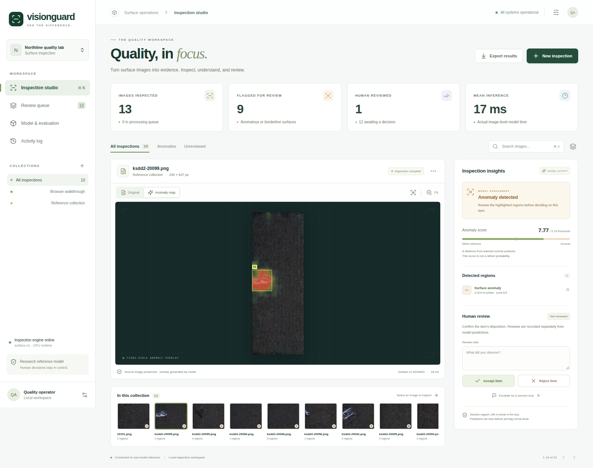

# VisionGuard

**Visual quality, verified. A surface-inspection workspace with real anomaly localization and traceable human review.**




VisionGuard turns product surface images into anomaly maps, localized regions and reviewable inspection records.
It demonstrates computer vision and model operations alongside the language-model portfolio projects.

## The AI involved

A frozen ImageNet-pretrained ResNet18 extracts texture features at three resolutions. A PaDiM-style model fits
multivariate Gaussian distributions to normal patches, then measures a new image's Mahalanobis distance from
those distributions. A smoothed score map produces an anomaly overlay and connected-component bounding boxes.
This is a fitted normal-reference vision model, not a language model. It does not classify scratches versus
other named defect types. Scores are distances, not calibrated defect probabilities.

The implementation follows the core idea of [PaDiM](https://arxiv.org/abs/2011.08785), with explicit resize,
48 selected feature channels, covariance regularization, smoothing and percentile-scoring choices recorded in code.
It is not a claim to reproduce the paper's benchmark numbers.

## What you can do

- Upload up to 20 PNG, JPEG or WebP images to a named batch; inspect original pixels and fixed-scale heatmaps.
- Browse localized regions, anomaly scores, thresholds, processing state and model version.
- Accept, reject or escalate items with review notes and an audit trail. Reviews do not silently retrain the model.
- Search/filter inspection records, inspect the queue, and export workspace results as CSV or JSON.
- Inspect real validation/test metrics, the confusion matrix, data provenance and measured runtime.
- Use local SQLite or PostgreSQL, durable leased jobs, workspace isolation, and hosted OIDC claims.

## Recorded model results

Fitted on **1,000 normal training images** from KolektorSDD2. The official training set was split into
1,865 training and 466 validation images; thresholds were selected on validation only. All 1,004 official
test images were used once for the recorded evaluation.

| Metric | Official test result |
| --- | ---: |
| Image AUROC | 0.93796 |
| Image average precision | 0.81273 |
| Precision at validation threshold | 74.8% |
| Recall at validation threshold | 75.5% |
| Missed defects / false alarms | 27 / 28 |
| Sampled pixel AUROC | 0.97297 |
| Batched encoder + map time, CPU | 21.1 ms/image, batch size 8 |

Latency excludes disk I/O and API transport. Pixel evaluation uses a fixed stride on resized masks.
These are same-domain dataset measurements, not a factory SLA or a guarantee for arbitrary products.
See [raw evaluation](reports/evaluation.json), [model card](MODEL_CARD.md), and [validation](docs/VALIDATION.md).

## Run locally

Python 3.11/3.12, Node 22.12+, and a CPU are sufficient for the recorded path.

```bash
python -m venv .venv
source .venv/bin/activate
pip install -e '.[dev]'
cp .env.example .env
python scripts/download_release.py
npm ci --prefix frontend
npm run build --prefix frontend
python -m visionguard.seed
uvicorn visionguard.api:create_app --factory --host 127.0.0.1 --port 8003
```

Open **http://localhost:8003**. Local mode needs no token. Wait for the engine to become ready and the
reference images to finish processing. Select a thumbnail, switch to **Anomaly map**, and inspect the highlighted
regions. Add a review note and choose **Accept item**, **Reject item**, or **Escalate for a second look**.
The model/evaluation tab shows actual recorded measurements. API documentation is at `/docs`.

To test a new image, select **New inspection** and upload it. The supplied model is specific to the KSDD2
surface family and capture setup; unrelated photos are not a validated use case. PNG normalization removes
EXIF and other metadata while preserving the oriented source pixels.

## Reproduce model fitting and evaluation

```bash
pip install torch torchvision --index-url https://download.pytorch.org/whl/cpu
pip install -e '.[vision]'
python scripts/download_data.py
python -m visionguard.training --max-normal 1000 --dimensions 48 --batch-size 8
```

The first command downloads the original archive from ViCoS (approximately 814 MiB). An upstream duplicate
copy pair is accepted for exclusion only after byte-for-byte verification. The remaining images have no exact
image duplicates. The manifest records the source archive SHA-256. Fitting uses only normal training images;
validation uses defect masks to select operating thresholds. The untouched official test split is used for final
measurement. Physical-item grouping is unavailable in this release; image-level separation is not a guarantee
against all related-item leakage. Restart serving after changing the artifact.

Fitting saves an optional safetensors training checkpoint and exports an ONNX encoder plus non-pickle NumPy statistics.
The downloadable serving artifact contains the ONNX graph, statistics, SHA-256 manifest and evaluation provenance. Serving
uses ONNX Runtime CPU and requires neither PyTorch nor an external AI API. The model version includes a weight digest so saved inspections
remain attributable to their exact fitted artifact.

## Checks and deployment

```bash
ruff check .
ruff format --check .
pytest --cov=src --cov-report=term-missing
npm run check --prefix frontend
npm test --prefix frontend
npm audit --prefix frontend --audit-level=moderate
npm run build --prefix frontend
playwright install chromium
python scripts/browser_smoke.py
```

CI substitutes only the neural model in isolated workspace/browser fixtures. Separate recorded local checks
exercise actual ResNet18 features, fitted statistics, real image inference and a desktop/phone browser flow.

For PostgreSQL, set a fresh private `VISION_POSTGRES_PASSWORD` in `.env`, download the model artifact first,
then use `docker compose up --build -d`. The app port stays loopback-bound; PostgreSQL publishes no host port.
Public hosting requires OIDC, TLS, your hostname, proxy/request limits, backup/restore validation and workload
sizing. See [deployment](docs/DEPLOYMENT.md), [architecture](docs/ARCHITECTURE.md) and [security](SECURITY.md).

## Licensing and scope

Application code and original test fixtures are MIT. KolektorSDD2 data, sample images, dataset-derived model
statistics, and the dataset portions of screenshots retain **CC BY-NC-SA 4.0** terms. This bundled reference
artifact is for noncommercial research/portfolio use; commercial rights require the dataset owner's authorization.
Attribution and paper citation are in [DATA_LICENSE.md](DATA_LICENSE.md). Pretrained backbone weights retain
upstream terms. Do not describe this reference model as commercially licensed or production validated.
