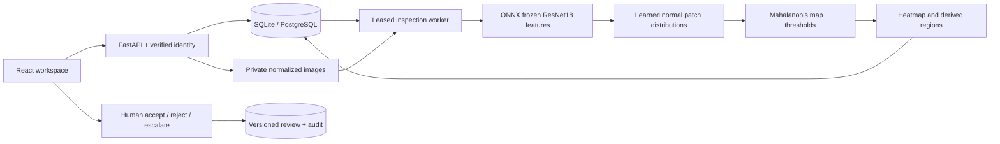

# Architecture

Workspace identity comes from local loopback access or verified JWT claims, never the upload body. Every
inspection, media read, audit query and export is scoped to that workspace. Images are shared within a workspace.

The worker atomically claims queued rows and uses a five-minute lease. Expired claims retry up to three times.
Completion is conditional on the matching claim attempt; stale workers cannot overwrite a reclaimed or deleted
job. A unique temporary overlay is renamed while the inspection row's write lock is held. Deletion tombstones
visibility before deleting files, so a concurrent result cannot revive the record.

Uploads are bounded at the request and file levels, decoded as single-frame PNG/JPEG/WebP, capped at 12 MP,
EXIF-oriented, converted to RGB and reencoded as private PNG. Normalized bytes define workspace-level duplicate
identity. Source paths use generated IDs and a tenant digest; client filenames are display metadata only.

The model is initialized in the background. /health is process liveness; /ready stays 503 until a verified
artifact is loaded. No synthetic model is silently selected. The CI fixture is a separate scripts/fixture_server.py
entry point and is never copied into the serving image.

Human reviews use optimistic revision checks and return 409 for stale writes. Model predictions and human
dispositions remain separate. CSV exports neutralize formula-leading user text; JSON preserves structured data.

Current schema bootstrap uses SQLAlchemy create_all. Introduce explicit versioned migrations before live schema
upgrades. Workspace summary reads are suitable for a portfolio workload; large installations need aggregate
queries, retention rules, indexed access-path measurement and a separately managed worker pool.
